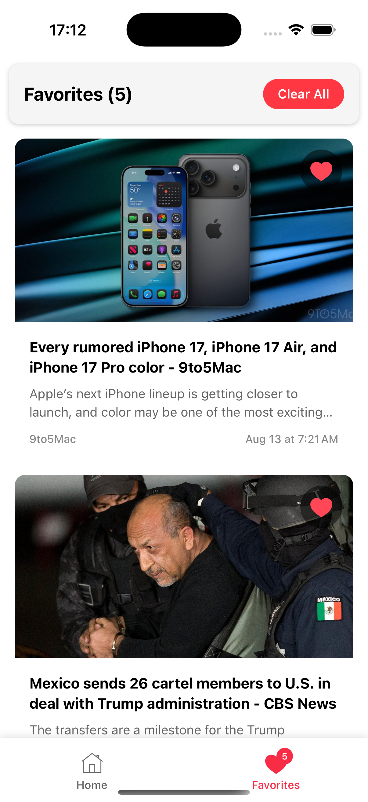
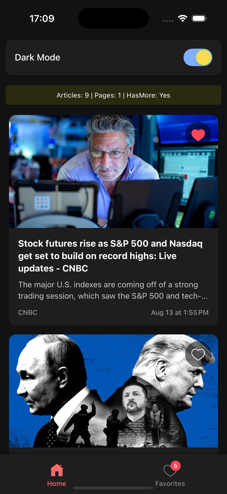
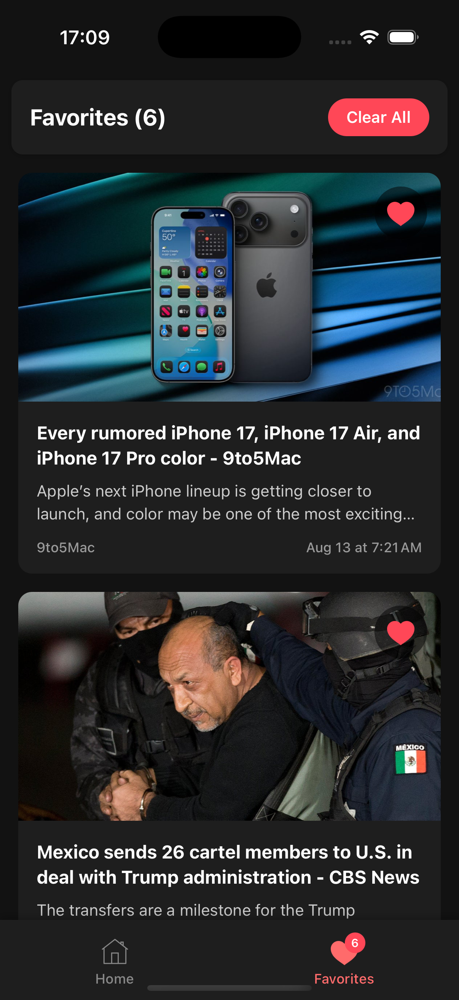
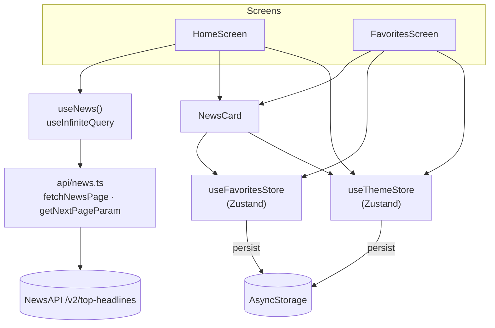

# NewsApp — React Native news reader

[](https://github.com/eshginfarzali/news_rn_app/actions/workflows/ci.yml)
[](LICENSE)


A bare React Native (CLI) app that streams top US headlines with infinite scroll and lets you keep favorite articles on the device, with a persisted dark/light theme.

> 🇦🇿 Azərbaycan dilində qısa təsvir [aşağıdadır](#-azərbaycanca).

<div align="center">
  
  
  
  
</div>

## Features

- **Infinite scroll** — top US headlines from [NewsAPI](https://newsapi.org/docs/endpoints/top-headlines), 10 per page, loaded with `useInfiniteQuery` as you approach the end of the list. Paging stops exactly when `totalResults` is reached.
- **Pull to refresh**, loading state, error state with **Try again**, and an end-of-feed message.
- **Favorites** — tap the heart on any article (with or without an image). Favorites are persisted with Zustand `persist` + AsyncStorage, survive restarts, show as a badge on the tab bar and can be cleared after a confirmation dialog.
- **Dark / light theme** toggle, persisted the same way and applied to React Navigation, the status bar and every screen.
- **Render performance** — `NewsCard` is memoized and subscribes to the store with narrow selectors, so toggling one favorite re-renders only that card; theme styles are pre-built `StyleSheet`s instead of inline objects.

## Tech stack

| Area       | Choice                                                                      |
| ---------- | --------------------------------------------------------------------------- |
| Runtime    | React Native 0.80 (CLI, New Architecture, Hermes), React 19                  |
| Navigation | React Navigation 7 — native stack + bottom tabs                              |
| Data       | TanStack Query v5 (`useInfiniteQuery`), `fetch`, NewsAPI v2                  |
| State      | Zustand 5 with `persist` middleware over AsyncStorage                        |
| Config     | `react-native-dotenv` (`.env` → `@env`)                                      |
| Language   | TypeScript (`strict`, via `@react-native/typescript-config`)                 |
| Quality    | ESLint (`@react-native` config, zero warnings), Prettier, Jest + React Native Testing Library |
| CI         | GitHub Actions — lint, format, typecheck, tests, Android debug build         |

## Architecture



```
App.tsx                 providers: SafeArea, QueryClient, NavigationContainer (themed)
src/api/news.ts         NewsAPI request + paging rule (pure, unit-tested)
src/hooks/useNews.ts    infinite query wiring
src/store/              Zustand stores + AsyncStorage adapter
src/screens/            Home (feed) and Favorites
src/components/         NewsCard
src/navigation/         root stack + bottom tabs
src/theme/palette.ts    light/dark palettes and pre-built themed styles
__tests__/              unit, component and screen tests
```

## Getting started

### Prerequisites

- Node.js 20+ (see `.nvmrc`)
- React Native environment for [Android and/or iOS](https://reactnative.dev/docs/set-up-your-environment) (JDK 17, Android SDK; Xcode + CocoaPods for iOS)
- A free [NewsAPI key](https://newsapi.org/register) — the free Developer plan is meant for development use only.

### Setup

```bash
git clone https://github.com/eshginfarzali/news_rn_app.git
cd news_rn_app
npm install
cp .env.example .env          # then set NEWS_API_KEY
npm start                     # Metro, in one terminal
npm run android               # or, for iOS:
cd ios && bundle install && bundle exec pod install && cd .. && npm run ios
```

`.env` is read at build time by Babel. After changing it, restart Metro with `npm start -- --reset-cache`.

> The key is bundled into the app, so anyone with the binary can extract it. That is fine for a demo; a production app should call NewsAPI through its own backend.

## Scripts

| Script                  | Description                         |
| ----------------------- | ----------------------------------- |
| `npm start`             | Start Metro                         |
| `npm run android`       | Build and run on Android            |
| `npm run ios`           | Build and run on iOS                |
| `npm run lint`          | ESLint with `--max-warnings 0`      |
| `npm run format`        | Format with Prettier                |
| `npm run format:check`  | Verify formatting                   |
| `npm run typecheck`     | `tsc --noEmit`                      |
| `npm test`              | Run Jest                            |
| `npm run test:coverage` | Jest with coverage                  |

## Testing

Jest (`react-native` preset) + React Native Testing Library. `fetch` is mocked at the network boundary, so screens run through the real TanStack Query and Zustand code.

| Suite                                  | What it covers                                                                 |
| -------------------------------------- | ------------------------------------------------------------------------------ |
| `api/news.test.ts`                     | request URL and params, `[Removed]` filtering, API error messages, missing key, `getNextPageParam` boundaries |
| `store/useFavoritesStore.test.ts`      | add (newest first), de-duplication by URL, remove, clear, persisted shape in AsyncStorage |
| `components/NewsCard.test.tsx`         | favorite toggle from the card, favoriting articles without an image            |
| `screens/HomeScreen.test.tsx`          | infinite scroll: page 2 on `onEndReached`, no request after the last page; error → retry |
| `screens/FavoritesScreen.test.tsx`     | empty state, "Clear All" through the confirmation dialog                       |
| `App.test.tsx`                         | app boots with navigation and renders the first headline                       |

```bash
npm test
```

## Roadmap

- [ ] Article detail screen / in-app browser when a card is tapped
- [ ] Category and country filters, search
- [ ] Offline reading: persist the query cache (`@tanstack/query-async-storage-persister`)
- [ ] Skeleton placeholders while loading
- [ ] Proxy NewsAPI through a small backend so the key is not shipped in the app
- [ ] E2E tests (Maestro or Detox) and a signed release build in CI

## License

[MIT](LICENSE) © Eshgin Farzaliyev

---

## 🇦🇿 Azərbaycanca

**NewsApp** — React Native CLI ilə yazılmış xəbər oxuyucusudur. ABŞ-ın əsas xəbərləri NewsAPI-dən gəlir və aşağı scroll etdikcə yeni səhifələr yüklənir (infinite scroll). Bəyəndiyin xəbəri ürək düyməsi ilə **favorite** edə bilərsən. Favorite-lər Zustand + AsyncStorage ilə cihazda saxlanılır və tətbiqi bağlayıb açanda itmir. Qaranlıq və işıqlı tema arasında keçid etmək olar, seçim də yadda saxlanılır.

**Texnologiyalar:** React Native 0.80, TypeScript, React Navigation 7, TanStack Query v5 (`useInfiniteQuery`), Zustand, AsyncStorage, Jest + React Native Testing Library.

**İşə salmaq:**

```bash
npm install
cp .env.example .env   # NEWS_API_KEY dəyərini yaz
npm start
npm run android        # və ya npm run ios
```

Testlər: `npm test`. Lint və tip yoxlaması: `npm run lint`, `npm run typecheck`.
