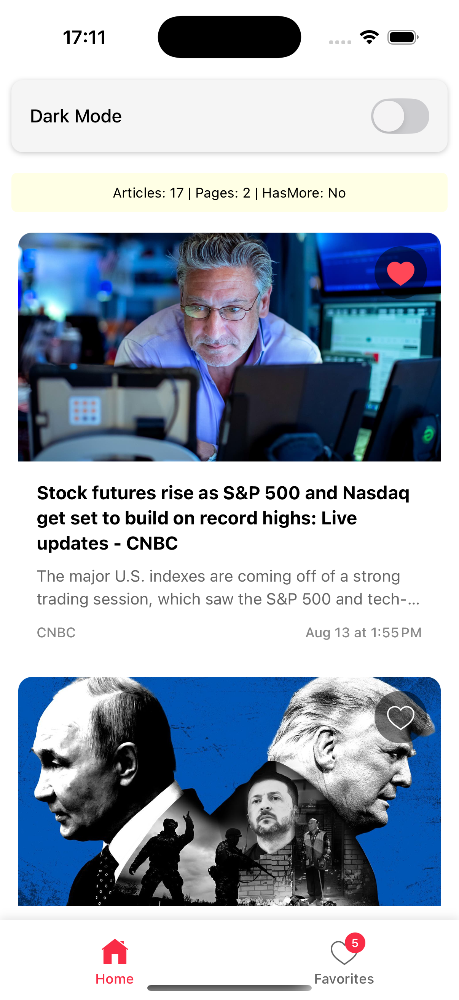

# NewsApp

## Təsvir
**NewsApp** reaktiv xəbər lentləri tətbiqidir. Xəbərlər API-dən alınır və scroll etdikcə yeni xəbərlər yüklənir (infinite scroll). İstifadəçi xəbərləri **favorite** edə bilər və bu məlumat lokal storage-də saxlanılır.  

---

## Əsas Xüsusiyyətlər
- Infinite Scroll (FlatList + pagination)
- Favorite əlavə etmək (lokal state + AsyncStorage/Zustand)
- Performans optimizasiyası (memoization)
- Dark/Light tema dəstəyi
- Offline dəstək (TanStack Query offline cache)

---

## Texniki Detallar

### Arxitektura və Texnologiyalar
- React Native + TypeScript
- Zustand – global state management
- AsyncStorage – lokal favorite məlumatların saxlanması
- TanStack Query – API data fetching və offline cache
- React Navigation – ekranlar arası navigation
- FlatList – infinite scroll üçün
- Skeleton Loader – Shimmer effect
- Dark/Light Theme toggle

---

## Quraşdırma və İstifadə

```bash
git clone <repository-url>
cd NewsApp
npm install
cd ios && pod install && cd ..
npm run ios  # iOS
npm run android  # Android
```

## Screenshots

<div style="display: flex; justify-content: space-between; gap:5px;">





</div>

